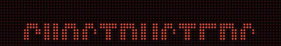
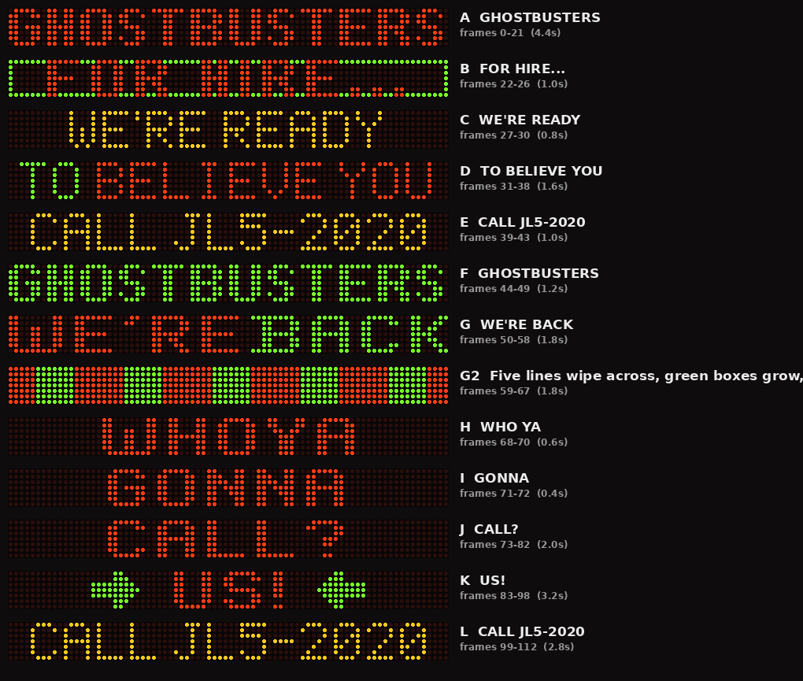
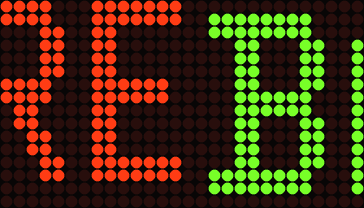

# Ecto-1A LED Sign — Screen-Accurate Recreation

A frame-by-frame recreation of the roof-mounted dot-matrix sign from the **Ecto-1A** in *Ghostbusters II* (1989), packaged for CoolLED1248 LED panels and exported in open formats for any other LED sign, app or microcontroller project.



**Download (pick one):**
- **Single file:** [`Ecto-1A_GB2_16x96.jt`](dist/Ecto-1A_GB2_16x96.jt). The whole loop fits in one file, so timing is compressed (22.6 s).
- **Two files, screen-timed:** [`Part1.jt`](dist/two_part/Ecto-1A_GB2_16x96_Part1.jt) + [`Part2.jt`](dist/two_part/Ecto-1A_GB2_16x96_Part2.jt). Load both onto the panel to play in order. With twice the frames, the holds follow real timings (44.2 s).

| | |
|---|---|
| Sign model | 80 × 7 pixels, red + green (both lit = amber) |
| Sequence | 13 segments. Single file: 113 frames, 22.6 s. Two-part: 112 + 109 frames, 44.2 s. All at 200 ms/frame |
| Fonts | 3, traced from reference photos |
| Attribution | every element traced to a source — [ATTRIBUTION.md](docs/ATTRIBUTION.md), with [evidence cards](docs/evidence/) showing each source extract beside our rendering |
| CoolLED files | `aniType 1` (3-bit colour). Single: 65,088 bytes. Part 1: 64,512. Part 2: 62,784. All inside the app's 65,535-byte upload limit |
| Verified | Byte-for-byte encoder match with app-exported files; decoded with zero errors by JT-Edit's own import code |

This project builds directly on research by the GBFans community. See **[Credits](#credits)**.

---

## Contents

- [Quick start](#quick-start)
- [What the sign does](#what-the-sign-does)
- [How it was made](#how-it-was-made)
- [What's sourced vs. estimated](#whats-sourced-vs-estimated)
- [Files](#files)
- [Using it in other LED apps](#using-it-in-other-led-apps)
- [Regenerating or customising](#regenerating-or-customising)
- [Credits](#credits)
- [Legal](#legal)

Detailed documentation:
[Design](docs/DESIGN.md) · [JT file format](docs/JT_FORMAT.md) · [Porting guide](docs/PORTING.md) · [Attribution audit](docs/ATTRIBUTION.md) · [Evidence cards](docs/evidence/) · [Validation](docs/VALIDATION.md) · [Research log](docs/RESEARCH.md) · [GBFans post](docs/GBFANS_POST.md)

---

## Quick start

### CoolLED1248 (16×96 panel)

1. Download either the single file [`Ecto-1A_GB2_16x96.jt`](dist/Ecto-1A_GB2_16x96.jt), or both [`Part1`](dist/two_part/Ecto-1A_GB2_16x96_Part1.jt) and [`Part2`](dist/two_part/Ecto-1A_GB2_16x96_Part2.jt), to your phone.
2. **Android:** open your Files app, tap the file, choose **Open with → CoolLED1248**. App versions 2.x import `.jt` files; if an import fails, the JT-Edit author recommends version 2.1.4.
3. Send it to the panel from the app. For the two-part version, import both and add them to the panel's playlist in order: **Part 1, then Part 2**. Part 2 ends with CALL JL5-2020 sliding down, and Part 1 opens with GHOSTBUSTERS rising, so the loop is seamless.

> **iOS:** `.jt` import on iOS has not been confirmed. As a workaround, load the file into the browser-based [JT-Edit](https://jt-edit.com/) editor.

**Other panel sizes:** the `.jt` file must match your panel. 16×96 is the smallest common CoolLED size that fits the sign at 1:1. For other sizes, see [Regenerating or customising](#regenerating-or-customising).

### Anything else

Use the files in [`dist/`](dist/): GIF, per-frame PNGs, sprite sheet, JSON, or an Arduino/C header. See [Using it in other LED apps](#using-it-in-other-led-apps).

---

## What the sign does



| ID | Shows | Effect | Time |
|---|---|---|---|
| A | GHOSTBUSTERS | rises in red, shimmer on green *(inferred look)*, 16 rapid red/green swaps, solid green | 4.4 s |
| B | FOR HIRE… | wiped in from green *(inferred, left to right)*; red text inside a green border; green wipe out | 1.0 s |
| C | WE'RE READY | wiped in from green *(inferred)*; **WE'RE first, then READY** *(inferred word-by-word build)*; font and colour unknown (shown thin, amber) | 0.8 s |
| D | TO BELIEVE YOU | thin font; **the highlight moves word by word: TO (green), BELIEVE (amber), YOU (green, inferred)**, with the other words red; wipes down as E slides in | 1.4 s |
| E | CALL JL5-2020 | thin font, amber; red wipe out *(inferred, left to right)* | 1.0 s |
| F | GHOSTBUSTERS | wiped in green from red, shimmer *(inferred look)*, green, green→red wipe, solid red | 1.2 s |
| G | WE'RE BACK | green flash, then WE'RE (red) BACK (green), words swap colours | 1.6 s |
| G2 | (graphic) | **inferred reconstruction:** five red lines wipe across, green boxes grow, red sweeps back, green again | 1.8 s |
| H | WHO YA | red | 0.6 s |
| I | GONNA | colour unknown (shown red) | 0.4 s |
| J | CALL? | red; slides up and out; sign blank about 0.8 s | 2.0 s |
| K | US! | red; alone, then green arrows on / off / on | 3.2 s |
| L | CALL JL5-2020 | revealed from the centre while the arrows stay lit; slides down; GHOSTBUSTERS rises to restart | 2.8 s |

The segment IDs follow the A–L scheme from the GBFans reference thread.

**Three inferred reconstructions.** These effects are confirmed to exist, but their exact look isn't documented, so they're best-effort reconstructions, labelled *inferred* everywhere:

- **Five lines → green boxes (G2).** The colours, phase order and approximate spacing come from the deleted-scene clip. The geometry is inferred: 16-column sections, full-height fill, step counts.
- **Colour wipes** (A→B, B→C, E→F, and green→red in F). The colours are sourced. The direction is inferred as left to right, because red sweeps in from the left on this sign in the clip.
- **Shimmer** (A and F). When and where it happens is sourced; its look is inferred as random per-pixel sparkle.

See [docs/ATTRIBUTION.md](docs/ATTRIBUTION.md) and the [evidence cards](docs/evidence/). Drawing them would mean inventing them. Instead, the confirmed frame is held, or a solid colour frame stands in for the wipe. See [docs/ATTRIBUTION.md](docs/ATTRIBUTION.md).

---

## How it was made

1. **Format research.** The CoolLED1248 `.jt` format was taken from the open-source [JT-Edit](https://github.com/auc0le/JT-Edit) editor and the [coolledx-driver](https://github.com/UpDryTwist/coolledx-driver) Python driver. The upload protocol stores frame count in 1 byte and payload length in 2 bytes. That caps a 16×96 animation at **113 frames**. Full specification: [docs/JT_FORMAT.md](docs/JT_FORMAT.md).
2. **Sign research.** The GBFans reference thread supplied the hardware model, every message and the playback order. It also supplied a scene-by-scene analysis of the film, deleted scenes, behind-the-scenes footage and the 1989 premiere footage.
3. **Photo analysis.** Reference stills from the thread were enlarged and sampled on a fitted 80×7 grid, with perspective correction where the sign is tilted. This revealed **three distinct fonts**, the FOR HIRE border, the amber CALL frame, the TO BELIEVE YOU colour states and the US! arrows. See [docs/DESIGN.md](docs/DESIGN.md).
4. **Generator.** A single Python script ([`src/ecto1a/generate.py`](src/ecto1a/generate.py)) builds the 80×7 sequence. It then maps it onto the panel and encodes the `.jt` file, along with every export in `dist/`.
5. **Hardware detail.** On the real sign the green LED clusters sit slightly lower than the red ones. You can see this in the film when "WE'RE" (red) and "BACK" (green) are lit together. The panel version uses 2 panel rows per sign row and draws green half a sign-pixel lower to reproduce this:

   

6. **Validation.** The encoder reproduces four CoolLED1248 app-exported files byte-for-byte. The output is decoded by JT-Edit's own import function with zero mismatches, and a test suite checks the protocol limits and layout facts. See [docs/VALIDATION.md](docs/VALIDATION.md).

The project went through four iterations as more reference material surfaced. They are documented in [docs/RESEARCH.md](docs/RESEARCH.md).

---

## What's sourced vs. estimated

| Element | Status | Basis |
|---|---|---|
| 80×7 matrix, red + green clusters, green sits lower | **Sourced** | GBFans thread hardware analysis + close-up photos |
| Every message and its spelling (incl. the apostrophe in WE'RE) | **Sourced** | GBFans thread |
| Playback order A–L | **Sourced** (one gap inferred by the thread) | Film, deleted scenes, premiere footage |
| GHOSTBUSTERS font + red / red-green flashing | **Sourced** | Night still, sampled on grid |
| WE'RE BACK font, layout (cols 0–79), red/green split | **Sourced** | Hi-res book scan, read pixel-for-pixel |
| FOR HIRE… red with green border | **Sourced** | Night still |
| TO BELIEVE YOU thin font; TO green and BELIEVE amber, each with the other words red | **Sourced** | Film still, museum still, premiere close-up |
| Word-by-word highlight TO → BELIEVE → YOU | **Sourced** (owner observation) / YOU's colour and the rate **inferred** | Ryan's observation; consistent with the stills, where one word at a time is lit |
| WE'RE READY built word by word (WE'RE, then READY) | **Inferred** | The "WE'RE"-alone frame described in the Getty footage, which Ryan attributes to WE'RE READY rather than WE'RE BACK |
| Two-part screen timings | **Measured** (J–L), **sourced** (16 swaps; shimmer "a few seconds") / **estimated** (2.0 s message holds, from the measured 2.1 s CALL JL5-2020 hold) | Deleted-scene clip; thread |
| CALL JL5-2020 thin font, amber | **Sourced** | Premiere close-ups |
| US! red with inward green arrows | **Sourced (shape approximate)** | Heavily motion-blurred premiere frames |
| Slides, 16 red/green swaps, solid colour frames, word colour swaps, arrow blink | **Sourced** | Thread's frame-by-frame descriptions |
| Wipes: occurrence and colours / direction and steps | **Sourced** / **Inferred** | Thread (Getty, film) / left-to-right sweep seen in the clip |
| Shimmer: occurrence (A, F) / look | **Sourced** / **Inferred** | Thread (Getty, film, behind-the-scenes) / random sparkle |
| WE'RE READY font and colour | **Unknown** (shown thin, amber) | No clear reference |
| WHO YA and CALL? colour (red) | **Sourced** | Deleted-scene clip, colour-calibrated |
| J–L timing (blank, arrow blink, centre reveal, holds) | **Sourced** | Deleted-scene clip, measured |
| GONNA colour; WHO YA / GONNA / CALL? letter shapes | **Estimate** | Bold-wide font assumed |
| Lines → boxes graphic (G2): occurrence, colours, phase order | **Sourced** | Thread (Getty analysis); deleted-scene clip |
| Lines → boxes graphic (G2): section width, divider position, fill height, step count | **Inferred** | Clip spacing matches 5 × 16 columns within error |
| Timing of A–I | **Estimate**, compressed | 113-frame upload limit |

---

## Files

| Path | What |
|---|---|
| [`dist/Ecto-1A_GB2_16x96.jt`](dist/Ecto-1A_GB2_16x96.jt) | CoolLED1248 animation, 16×96 panel, single file (compressed timing) |
| [`dist/two_part/Ecto-1A_GB2_16x96_Part1.jt`](dist/two_part/Ecto-1A_GB2_16x96_Part1.jt), [`Part2.jt`](dist/two_part/Ecto-1A_GB2_16x96_Part2.jt) | Screen-timed version as two CoolLED files: Part 1 = A–F, Part 2 = G–L |
| [`dist/two_part/ecto1a_96x16_full.gif`](dist/two_part/ecto1a_96x16_full.gif) | Preview of the screen-timed version (both parts) |
| [`dist/two_part/ecto1a_full_frames.json`](dist/two_part/ecto1a_full_frames.json), [`ecto1a_full_playlist.json`](dist/two_part/ecto1a_full_playlist.json) | Screen-timed frames for other apps (221 frames / 62 unique) |
| [`dist/ecto1a_96x16_panel.gif`](dist/ecto1a_96x16_panel.gif) | Preview as it appears on the panel |
| [`dist/ecto1a_80x7.gif`](dist/ecto1a_80x7.gif) | Native 80×7 LED-style preview |
| [`dist/frames_80x7/`](dist/frames_80x7/) | 113 PNGs, 1 image pixel = 1 sign pixel |
| [`dist/ecto1a_spritesheet_80x7.png`](dist/ecto1a_spritesheet_80x7.png) | All frames stacked vertically (80 × 791) |
| [`dist/ecto1a_frames.json`](dist/ecto1a_frames.json) | Every frame as an 80×7 array of 0–3, plus timeline |
| [`dist/ecto1a_playlist.json`](dist/ecto1a_playlist.json) | Deduplicated: unique frames + {frame, ms} playlist |
| [`dist/ecto1a_frames.h`](dist/ecto1a_frames.h) | C/Arduino header, 2 bits/pixel, PROGMEM-ready |
| [`src/ecto1a/generate.py`](src/ecto1a/generate.py) | Generator (fonts, sequence, encoder, exports) |
| [`tests/`](tests/) | pytest suite |
| [`tools/`](tools/) | JT-Edit cross-check, doc image renderer |

---

## Using it in other LED apps

Pixel values everywhere are **0 = off, 1 = red, 2 = green, 3 = red + green**. On RGB panels, map 3 to amber/yellow.

- **Apps that import GIFs:** use `ecto1a_80x7.gif`, or build a crisp 80×7 GIF from the PNG frames.
- **Apps that import frame images:** `frames_80x7/frame_000.png` … `frame_112.png`, each shown for 200 ms. Many frames repeat; `ecto1a_playlist.json` gives the deduplicated version with durations.
- **Arduino / ESP32 / Pi:** `ecto1a_frames.h` has 47 unique frames at 140 bytes each (6.4 KB), plus a 78-step playlist.
- **Your own code:** `ecto1a_frames.json`, or the screen-timed `two_part/ecto1a_full_frames.json` / `ecto1a_full_playlist.json`. These aren't bound by CoolLED's frame limit, so they're the better choice for microcontroller builds.

Step-by-step recipes (GIF building, scaling to other panel sizes, Arduino example, red/green-only hardware) are in **[docs/PORTING.md](docs/PORTING.md)**.

---

## Regenerating or customising

Requires Python 3.9+ and Pillow.

```bash
pip install pillow pytest
cd src && python -m ecto1a.generate --out ../dist && cd ..
python tools/make_doc_images.py
python -m pytest -q tests
```

- **Panel size:** `PANEL_W` / `PANEL_H` in `generate.py`. Panels at least 80 wide work as-is. Keep `frames × width × ceil(height/8) × 3 ≤ 65,535` bytes.
- **Timing:** `DELAY_MS` and the `hold(...)` counts in `build_segments()`.
- **Fonts/colours:** the glyph tables at the top of `generate.py` are plain `#`/`.` strings.

---

## Credits

This recreation rests on the community research in the GBFans thread **[Screen Accurate ECTO-1A Dot Matrix LED Sign (Reference)](https://forum.gbfans.com/t/screen-accurate-ecto-1a-dot-matrix-led-sign-reference/26454)**:

- **prodestrian** — started and led the reference effort: the 80×7 red/green hardware model, the red/green vertical offset, the full text inventory, the A–L sequence, and the scene-by-scene film, deleted-scene and premiere footage analysis.
- **zerosum** — pixel-placement maps, screen grabs from the premiere footage, and the book scan of WE'RE BACK that anchored the bold-wide font.
- **Kingpin** — found the 1989 premiere footage (YouTube and Getty Images), and confirmed the "yellow" is red and green lit together.
- **d_osborn** — pointed to the Electronic Press Kit, and contributed close-up photos.
- Everyone else in the thread who contributed observations.

Tools and format knowledge:

- **[JT-Edit](https://github.com/auc0le/JT-Edit)** by auc0le (GPL-3.0) — JT format and decoder, used to verify our files. It is not included in this repo.
- **[coolledx-driver](https://github.com/UpDryTwist/coolledx-driver)** by UpDryTwist — CoolLED upload protocol and its size limits.

Project by **Ryan Brumback**, built with AI assistance (Anthropic's Claude).

## Legal

Fan project for non-commercial use. *Ghostbusters*, *Ghostbusters II*, Ecto-1 and related marks are the property of Columbia Pictures / Sony Pictures. This project is not affiliated with or endorsed by them.

Code and generated data are released under the [MIT License](LICENSE). The small source extracts in [`docs/evidence/`](docs/evidence/) are third-party images (film stills, Getty Images news footage, a book scan), included only for attribution and comparison, with credits. They are **not** covered by the MIT licence.
