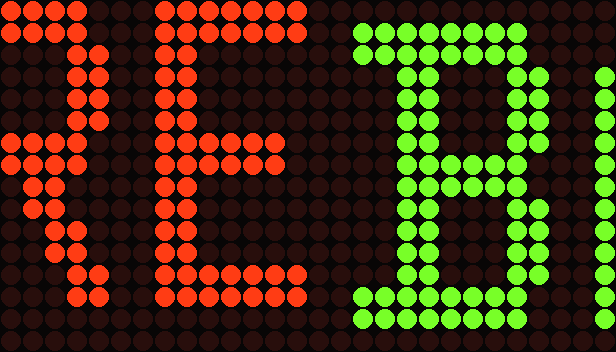
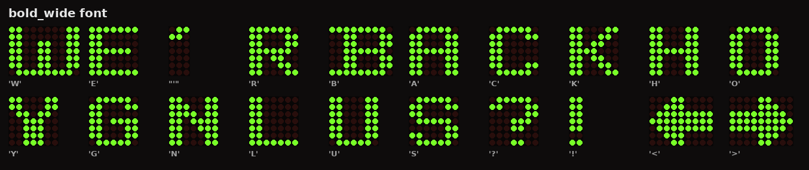
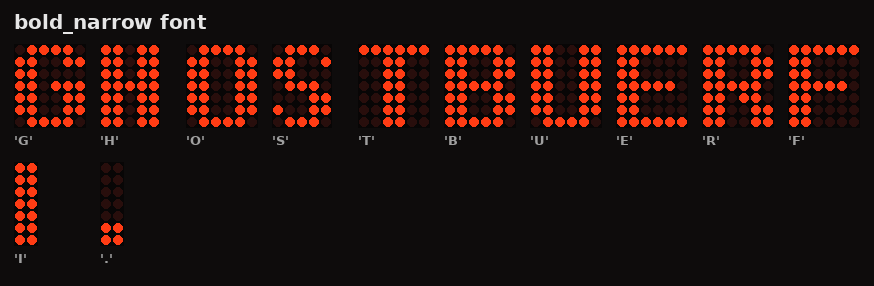
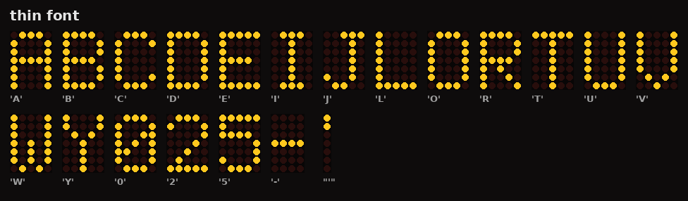
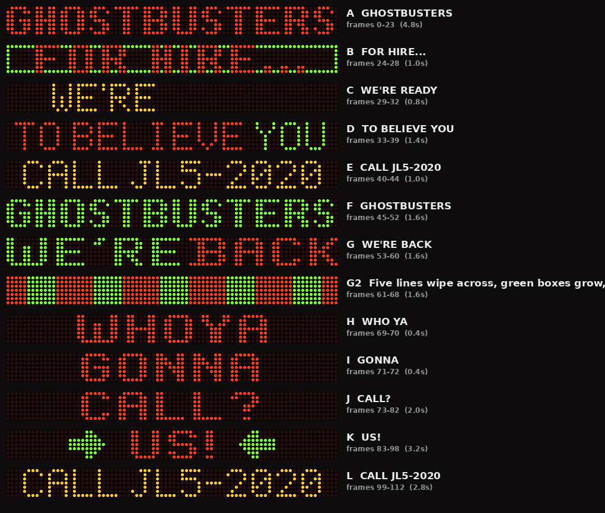
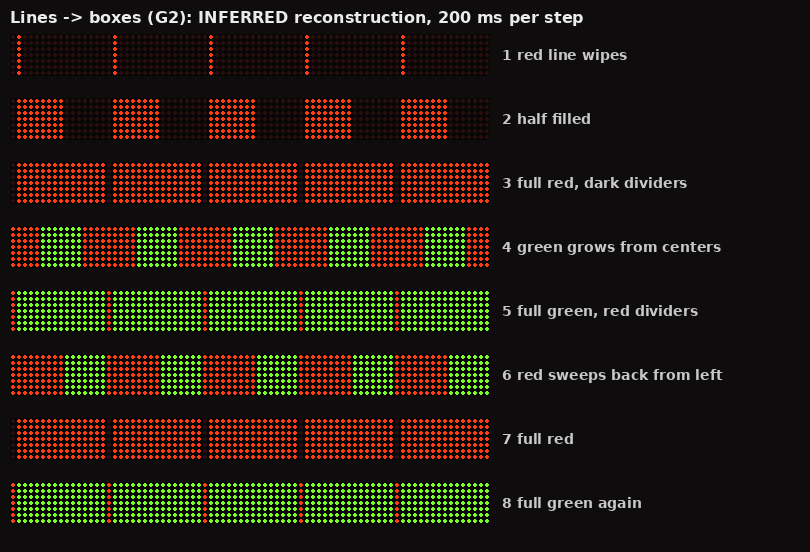
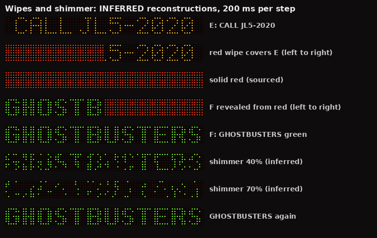

# Design

This document records how every element of the recreation was decided: what the reference showed, how it was measured, and what was estimated.

## 1. The physical sign

| Property | Value | Source |
|---|---|---|
| Resolution | 80 × 7 pixels | GBFans thread (counted from film frames) |
| Pixel | a cluster of 4 LEDs, never driven separately | GBFans thread close-ups |
| Colours | separate red and green clusters per pixel; both lit reads as amber | GBFans thread |
| Vertical offset | green clusters sit lower than red | GBFans thread; visible in the WE'RE BACK scan |
| Count | 560 pixels per colour, 4,480 LEDs per sign | GBFans thread |
| Two signs | one per side, always showing the same content | GBFans thread |
| Manufacturer | unknown | thread investigation is ongoing |

### Modelling choices

- **Logical model:** 80 × 7 grid, each pixel `0` off, `1` red, `2` green, `3` both. This matches the 4-state encoding prodestrian proposed in the thread, so the data can be shared with other projects as-is.
- **Panel mapping (16×96):** the 80 columns map 1:1, centred with 8 columns of margin each side. Each sign row becomes 2 panel rows. Red uses panel rows `2y, 2y+1`; green uses `2y+1, 2y+2`. So green sits half a sign pixel lower, as on the real hardware. A red+green pixel shows red on top, amber in the middle, and green underneath. 15 of the 16 panel rows are used.

## 2. Fonts

The sign uses three fonts. They were identified by enlarging the reference stills and sampling them on a fitted 80×7 grid; where the sign was photographed at an angle, the grid was perspective-corrected.

### Bold wide — WE'RE BACK, WHO YA, GONNA, CALL?, US!

- Letters are 7 columns wide with 2-pixel strokes. Letters are separated by 2 blank columns, and words by 2.
- **B, A, C, K** were read pixel-for-pixel from the green half of the hi-res WE'RE BACK book scan, where every LED cluster is distinct. B has a 2-column serif on its top and bottom rows.
- **W, E, ', R** were read from the red half of the same scan. The red is softer, so these are slightly less certain. W is 10 wide, with an "LIJ" shape: a centre stroke from row 2 and joined feet.
- **Check:** W10+E7+'3+R7+E7 plus gaps is 42 columns, a 2-column space follows, and B9+A7+C7+K7 plus gaps is 36 columns. That totals exactly **80**, so the phrase fills columns 0–79 as in the photo.
- H, O, Y, G, N, L, U, S, ?, ! are drawn in the same style but **not seen in any reference** (estimate).
- `<` and `>` are the US! arrows. In both premiere frames the shaft runs away from the word and the tall head faces it, so both arrows point inward.

### Bold narrow — GHOSTBUSTERS, FOR HIRE…

- Letters are 6 wide (H and S are 5), with 2-pixel strokes and 1-column gaps.
- Sampled from the night GHOSTBUSTERS still with a tilted-grid fit. **GHOSTBUSTERS spans columns 0–78**, edge to edge as in the photo.
- FOR HIRE… uses the same font with 2-column letter gaps and 6-column word spaces, which matches its looser spacing in the still. The ellipsis is three 2×2 dots.

### Thin 5×7 — TO BELIEVE YOU, CALL JL5-2020 (and WE'RE READY, unconfirmed)

- Classic 5×7 with 1-column gaps and 3-column spaces.
- Confirmed by premiere-footage close-ups of CALL, BELIEVE and a thin amber "WE". In the close-up, the E's top and bottom rows are 5 pixels and its middle row is 4.
- TO BELIEVE YOU is 75 columns wide, so it fills the sign, matching the film still.

## 3. Colours per frame

| Frame | Colours | Evidence |
|---|---|---|
| A GHOSTBUSTERS | red; green; ~16 red/green swaps; settles green | night still (red); thread: film 01:22:59 and Getty clip |
| B FOR HIRE… | red text, green border | night still |
| C WE'RE READY | **unknown**, shown amber (font also unconfirmed); built word by word, WE'RE then READY (**inferred**) | no clear reference; the build mirrors WE'RE BACK's WE'RE-alone frame |
| D TO BELIEVE YOU | all red → TO green → BELIEVE amber → YOU green (**inferred colour**) → all red; the other words stay red | states in P3, P8, P16; the word-by-word order is Ryan's observation; the rate is estimated |
| E / L CALL JL5-2020 | amber | premiere close-ups (red and green clusters both lit) |
| F GHOSTBUSTERS | green, then red | thread (film 01:23:28; Getty clip) |
| G WE'RE BACK | WE'RE red, BACK green, then swapped | book scan; thread (Getty clip) |
| H WHO YA | red | deleted-scene clip V1, measured |
| I GONNA | **unknown**, shown red | not visible in V1 |
| J CALL? | red | V1, measured |
| K US! | red word, green arrows | premiere frames |

## 4. Sequence and effects

The order and the transitions come from the thread's analysis of the film (timecodes 00:37:06, 00:38:10, 00:49:44, 01:22:59–01:24:54), deleted scenes, behind-the-scenes footage, and the 42-second Getty premiere clip. **Only effects whose appearance is documented are drawn.** Per-element sources are in [ATTRIBUTION.md](ATTRIBUTION.md).

| Effect | Implementation | Source |
|---|---|---|
| L slides down, A slides up (red) | content shifted 2–3 rows per frame | film 01:23:17; museum arrival |
| J slides up and out, then blank about 0.8 s | as above; then 4 blank frames | Getty clip; V1 |
| US! alone, then arrows on/off/on | 3 frames alone; arrows 6 on, 4 off, 3 on | V1 |
| US! → CALL JL5-2020 | text revealed outward from the centre, in 2 steps, while the arrows stay lit | V1 frames 132–137 |
| D wipes down as E slides in from the top | E above D on a 15-row strip, viewed at offsets 5, then 2 | film 01:24:46; Getty clip |
| Red/green swaps (A) | the same glyphs alternate colour every frame, 16 times | Getty clip: "about 16 times" |
| Colour wipe (A→B, B→C, E→F, F green→red) | **INFERRED (v7):** the colour advances **left to right** over the old message in a half step, then a solid frame (where the thread reports one), then the new message is revealed left to right. The colours are sourced. The direction is inferred from the left-to-right red sweep on this sign in V1 frames 20–23. | thread reports the colours |
| Green → red (F) | cut | thread |
| Solid red (F→G), green flash (G) | one solid frame | Getty clip |
| Word colour swap (G) | WE'RE/BACK alternate red/green | Getty clip |
| Static border (B) | perimeter pixels green where the text is unlit | FOR HIRE still |
| Arrow blink (K) | arrows on/off over 5 frames | Getty clip |

### Inferred: five lines → green boxes (G2)

Rendered as a best-effort reconstruction. The thread describes five vertical lines, each wiping across before being replaced by a green box, looping several times. The deleted-scene clip (V1, frames 8–30, about 1.9 s) shows the right third of the sign, out of focus.

| Step | Frame | Sourced from V1 / thread | Inferred |
|---|---|---|---|
| 1–3 | red line → half fill → full red; dark dividers | red wipe fill with dark dividers (V1 8–14); "each one wipes across" (thread) | 5 sections × 16 columns; divider in each section's column 0; left-to-right; 3 steps |
| 4–5 | green grows from each section's centre to full; dividers red | green growing outward from points in each section, red dividers (V1 15–19) | growth from the exact centre; full height; 2 steps |
| 6–7 | red sweeps back from the left → full red | red re-entering from the left of each section (V1 20–25) | half then full; 2 steps |
| 8 | full green again | second green phase (V1 26–30); "loops multiple times" (thread) | 1 step (v7, to fit the wipes); loop count 1.5 |

Scale check: the green seeds are about 21 px apart at about 1.46 px per column (taken from the width of CALL JL5-2020 in the same shot). That is 14–15 columns, consistent with five 16-column sections.

### Inferred: shimmer (A and F)

The thread reports GHOSTBUSTERS shimmering while green: in A for a few seconds before the red/green swaps (Getty clip), and in F after the red wipe (film 01:23:28; behind-the-scenes footage shows GHOSTBUSTERS, the shimmer, then GHOSTBUSTERS again). Nobody has documented its look, so it is rendered as **random per-pixel sparkle**: lit pixels drop out with rising, then falling, probability (A: 30%, 60%, 30%; F: 40%, 70%). A fixed seed keeps it reproducible.

### Known but not rendered

| Effect | Where | Why it's not drawn |
|---|---|---|
| Possible slide/flip in A | A | the thread hedges it ("seems", "possibly") |

## 5. Timing

The CoolLED1248 format has **one delay for the whole animation**. Holds are therefore made by repeating frames. The upload protocol limits a 16×96 animation to 113 frames (65,535 bytes ÷ 576 bytes per frame).

At 200 ms per frame this gives a 22.6-second loop of 113 frames, exactly at the upload limit. **J–L are timed from the deleted-scene clip (V1)**: CALL? about 0.8 s, blank 0.8 s, US! 3.2 s with arrows, CALL JL5-2020 about 2.4 s including the reveal. **All other durations are estimates.** Holds of 0.4–0.8 s were shortened to fit the measured segments and the inferred G2 graphic, wipes and shimmer within the 113-frame limit, and are likely shorter than the real sign's. A microcontroller build is not bound by the frame limit: use `ecto1a_playlist.json` and stretch the holds.

### Two-part, screen-timed version

CoolLED panels can store several programmes and play them in order, so a second build splits the loop into **two files**, each within the 113-frame limit. Part 1 covers A–F (112 frames, 22.4 s) and Part 2 covers G–L (109 frames, 21.8 s), for 44.2 s in total. That doubles the frame budget, so the holds follow real timings: measured values for J–L, 2.0 s message holds based on the measured 2.1 s CALL JL5-2020 hold, a 1.2–1.6 s shimmer (the thread says "a few seconds"), two-step wipes, and three passes of the lines → boxes graphic. Per-element bases are in [ATTRIBUTION.md](ATTRIBUTION.md#timing).
