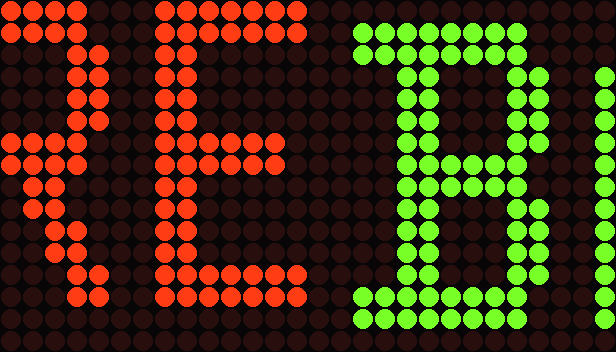
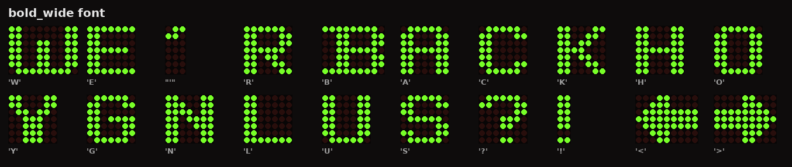
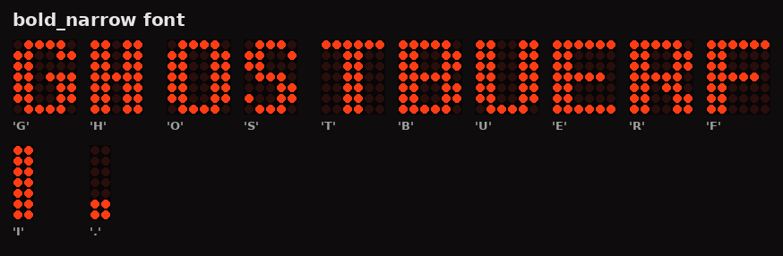
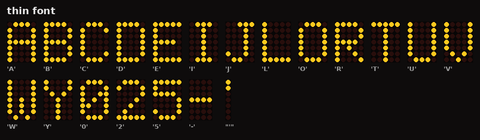
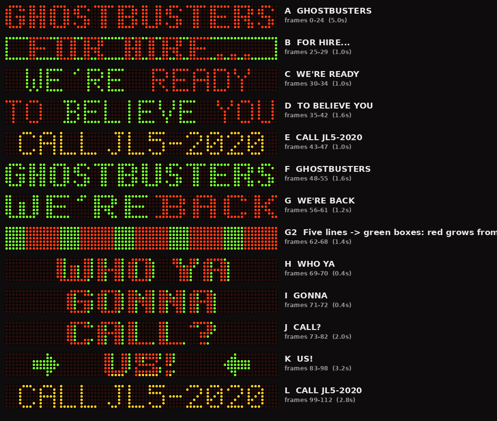
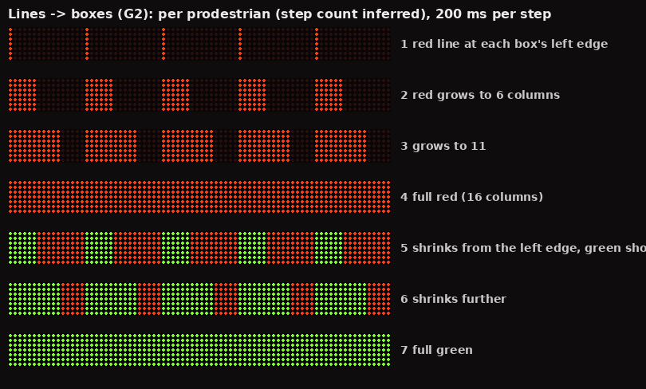
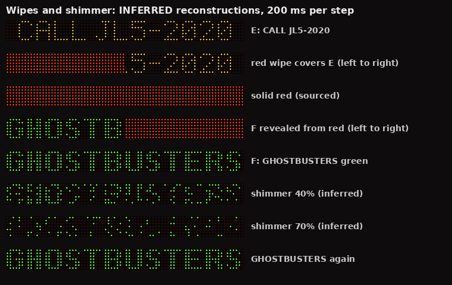

# Design

This document records how every element of the recreation was decided: what the reference showed, how it was measured, and what was estimated.

## 1. The physical sign

| Property | Value | Source |
|---|---|---|
| Resolution | 80 × 7 pixels | GBFans thread (counted from film frames) |
| Pixel | a cluster of 4 LEDs, never driven separately | GBFans thread close-ups |
| Colors | separate red and green clusters per pixel; both lit reads as amber | GBFans thread |
| Vertical offset | green clusters sit lower than red | GBFans thread; visible in the WE'RE BACK scan |
| Count | 560 pixels per color, 4,480 LEDs per sign | GBFans thread |
| Two signs | one per side, always showing the same content | GBFans thread |
| Manufacturer | unknown | thread investigation is ongoing |

### Modeling choices

- **Logical model:** 80 × 7 grid, each pixel `0` off, `1` red, `2` green, `3` both. This matches the 4-state encoding prodestrian proposed in the thread, so the data can be shared with other projects as-is.
- **Panel mapping (16×96):** the 80 columns map 1:1, centered with 8 columns of margin each side. Each sign row becomes 2 panel rows. Red uses panel rows `2y, 2y+1`; green uses `2y+1, 2y+2`. So green sits half a sign pixel lower, as on the real hardware. A red+green pixel shows red on top, amber in the middle, and green underneath. 15 of the 16 panel rows are used.

## 2. Fonts

The sign uses three fonts. They were identified by enlarging the reference stills and sampling them on a fitted 80×7 grid; where the sign was photographed at an angle, the grid was perspective-corrected.

### Bold wide — WE'RE BACK, WHO YA, GONNA, CALL?, US!

- Letters are 7 columns wide with 2-pixel strokes. Letters are separated by 2 blank columns, and words by 2.
- **B, A, C, K** were read pixel-for-pixel from the green half of the hi-res WE'RE BACK book scan, where every LED cluster is distinct. B has a 2-column serif on its top and bottom rows.
- **W, E, ', R** were read from the red half of the same scan. The red is softer, so these are slightly less certain. W is 10 wide, with an "LIJ" shape: a center stroke from row 2 and joined feet.
- **Check:** W10+E7+'3+R7+E7 plus gaps is 42 columns, a 2-column space follows, and B9+A7+C7+K7 plus gaps is 36 columns. That totals exactly **80**, so the phrase fills columns 0–79 as in the photo.
- H, O, Y, G, N, L, U, S, ?, ! are drawn in the same style but **not seen in any reference** (estimate).
- `<` and `>` are the US! arrows. In both premiere frames the shaft runs away from the word and the tall head faces it, so both arrows point inward.

### Bold narrow — GHOSTBUSTERS, FOR HIRE…

- Letters are 6 wide (H and S are 5), with 2-pixel strokes and 1-column gaps.
- Sampled from the night GHOSTBUSTERS still with a tilted-grid fit. **GHOSTBUSTERS spans columns 0–78**, edge to edge as in the photo.
- FOR HIRE… uses the same font with 2-column letter gaps and 6-column word spaces, which matches its looser spacing in the still. The ellipsis is three 2×2 dots.

### Thin 5×7 — WE'RE READY, TO BELIEVE YOU, CALL JL5-2020

- Classic 5×7 with 1-column gaps and 3-column spaces.
- Confirmed by premiere-footage close-ups of CALL, BELIEVE and a thin amber "WE". In the close-up, the E's top and bottom rows are 5 pixels and its middle row is 4.
- **WE'RE READY and TO BELIEVE YOU use prodestrian's pixel maps verbatim** (reference thread post #41, read from the Getty premiere footage). TO BELIEVE YOU fills the sign from column 0 to 79, with a single-stroke I; WE'RE READY spans columns 6–72.

## 3. Colors per frame

| Frame | Colors | Evidence |
|---|---|---|
| A GHOSTBUSTERS | red; green; ~16 red/green swaps; settles green | night still (red); thread: film 01:22:59 and Getty clip |
| B FOR HIRE… | red text, green border | night still |
| C WE'RE READY | all red → WE'RE green → READY green → all red; the other word stays red | prodestrian's pixel maps (#41); rate estimated |
| D TO BELIEVE YOU | all red → TO green → BELIEVE green → YOU green → all red; the other words stay red | prodestrian's pixel maps (#41); P3, P8; rate estimated |
| E / L CALL JL5-2020 | amber | premiere close-ups (red and green clusters both lit) |
| F GHOSTBUSTERS | green, then red | thread (film 01:23:28; Getty clip) |
| G WE'RE BACK | WE'RE red, BACK green, then swapped | book scan; thread (Getty clip) |
| H WHO YA, I GONNA, J CALL? | red letters with a green drop shadow one column to the right | letters measured red in V1; shadow from prodestrian (release topic #12), who reads the combination as amber in the Getty footage |
| K US! | red word with green drop shadow; green arrows (no shadow) | prodestrian's pixel map (release topic #12), used verbatim |

## 4. Sequence and effects

The order and the transitions come from the thread's analysis of the film (timecodes 00:37:06, 00:38:10, 00:49:44, 01:22:59–01:24:54), deleted scenes, behind-the-scenes footage, and the 42-second Getty premiere clip. **Only effects whose appearance is documented are drawn.** Per-element sources are in [ATTRIBUTION.md](ATTRIBUTION.md).

| Effect | Implementation | Source |
|---|---|---|
| L slides down, A slides up (red) | content shifted 2–3 rows per frame | film 01:23:17; museum arrival |
| J slides up and out, then blank about 0.8 s | as above; then 4 blank frames | Getty clip; V1 |
| US! alone, then arrows on/off/on | 3 frames alone; arrows 6 on, 4 off, 3 on | V1 |
| US! → CALL JL5-2020 | text revealed outward from the center, in 2 steps, while the arrows stay lit | V1 frames 132–137 |
| D wipes down as E slides in from the top | E above D on a 15-row strip, viewed at offsets 5, then 2 | film 01:24:46; Getty clip |
| Red/green swaps (A) | 16 frames cycling red, red upside-down, green, green upside-down | Getty clip: "about 16 times"; flip from prodestrian's clip (release topic #12). The order of upright and flipped states is **estimated** |
| WE'RE READY → TO BELIEVE YOU | right-to-left wipe: the new message replaces the old from the right edge | prodestrian (#41); the look of the edge is inferred |
| Drop shadow (H, I, J, K) | green pixel one column right of each lit letter pixel, where unlit | prodestrian (release topic #12) |
| Color wipe (A→B, B→C, E→F, F green→red) | **INFERRED (v7):** the color advances **left to right** over the old message in a half step, then a solid frame (where the thread reports one), then the new message is revealed left to right. The colors are sourced. The direction is inferred from the left-to-right red sweep on this sign in V1 frames 20–23. | thread reports the colors |
| Green → red (F) | cut | thread |
| Solid red (F→G), green flash opening G | one solid frame each | Getty clip |
| Word color swap (G) | WE'RE/BACK alternate red/green | Getty clip |
| Static border (B) | perimeter pixels green where the text is unlit | FOR HIRE still |
| Arrow blink (K) | arrows on/off over 5 frames | Getty clip |

### Five lines → green boxes (G2)

Five equal, full-height boxes of 16 columns fill the sign with **no gaps**. In each box a red line starts at the left edge and grows until it is 16 columns wide, then shrinks from that same edge, revealing green; the cycle loops. This follows prodestrian's pixel map and notes (reference thread #41, release topic #12), read from the Getty premiere footage, and matches the deleted-scene clip (V1, frames 6–31). The apparent gaps between boxes in footage are an optical illusion from the offset red and green LEDs, so v6–v10's divider columns are gone.

| Step | Frame |
|---|---|
| 1–4 | red grows from each box's left edge: 1, 6, 11, then 16 columns (the first pass draws over a dark sign; later passes over green) |
| 5–6 | red shrinks from the left edge: green shows in 6, then 11 columns |
| 7 | all green |

The number of steps is **inferred**. The screen-timed build uses finer steps (1, 4, 8, 12, 16 / 4, 8, 12) and three passes.

### Shimmer (A and F)

The thread reports GHOSTBUSTERS shimmering while green: in A for a few seconds before the red/green swaps (Getty clip), and in F after the red wipe (film 01:23:28; behind-the-scenes footage shows GHOSTBUSTERS, the shimmer, then GHOSTBUSTERS again). prodestrian sees the pattern in the Getty footage as partly repeating, and says a suitably randomized sequence is fine (#41). It is rendered as a **short repeating cycle of three random sparkle masks**: lit pixels drop out with rising, then falling, probability (A: 30%, 60%, 30%; F: 40%, 70%). A fixed seed keeps it reproducible. The exact pixels are inferred.

### Known but not rendered

| Effect | Where | Why it's not drawn |
|---|---|---|
| Possible bounce in A | A | the thread hedges it ("seems") |

The upside-down flip, previously listed here, is now drawn (v11) on prodestrian's evidence.

## 5. Timing

The CoolLED1248 format has **one delay for the whole animation**. Holds are therefore made by repeating frames. The upload protocol limits a 16×96 animation to 113 frames (65,535 bytes ÷ 576 bytes per frame).

At 200 ms per frame this gives a 22.6-second loop of 113 frames, exactly at the upload limit. **J–L are timed from the deleted-scene clip (V1)**: CALL? about 0.8 s, blank 0.8 s, US! 3.2 s with arrows, CALL JL5-2020 about 2.4 s including the reveal. **All other durations are estimates.** Holds of 0.4–0.8 s were shortened to fit the measured segments and the G2 graphic, wipes and shimmer within the 113-frame limit, and are likely shorter than the real sign's. A microcontroller build is not bound by the frame limit: use `ecto1a_playlist.json` and stretch the holds.

### Two-part, screen-timed version

CoolLED panels can store several programs and play them in order, so a second build splits the loop into **two files**, each within the 113-frame limit. Part 1 covers A–F (111 frames, 22.2 s) and Part 2 covers G–L (109 frames, 21.8 s), for 44.0 s in total. That doubles the frame budget, so the holds follow real timings: measured values for J–L, 2.0 s message holds based on the measured 2.1 s CALL JL5-2020 hold, a 1.2–1.6 s shimmer (the thread says "a few seconds"), two-step wipes, and three passes of the lines → boxes graphic. Per-element bases are in [ATTRIBUTION.md](ATTRIBUTION.md#timing).
