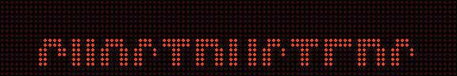
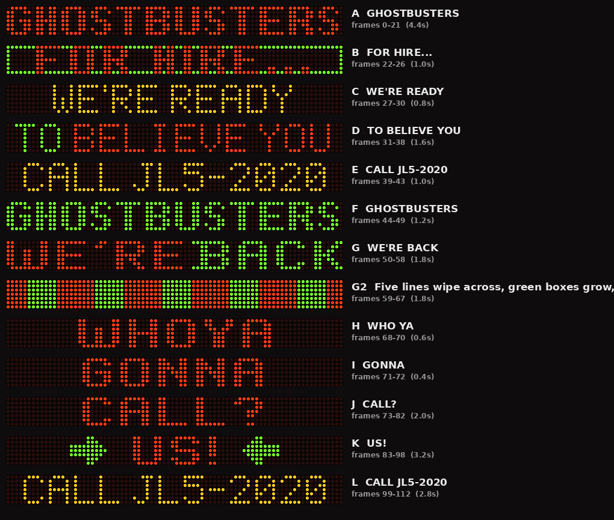
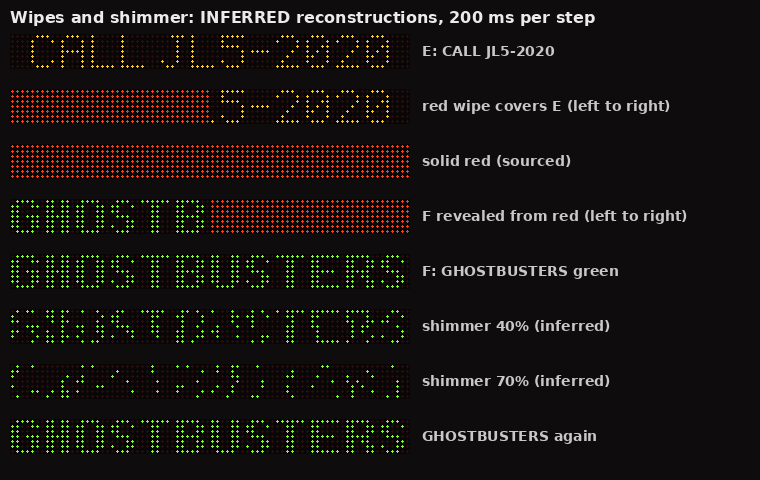
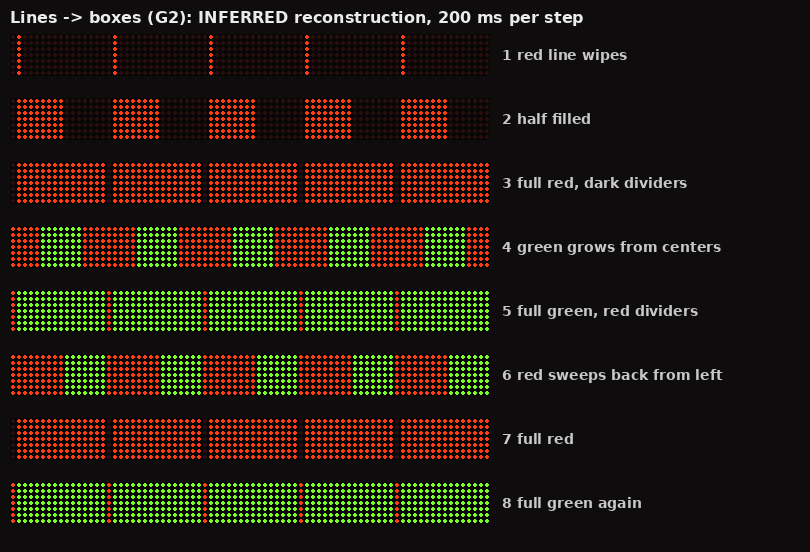
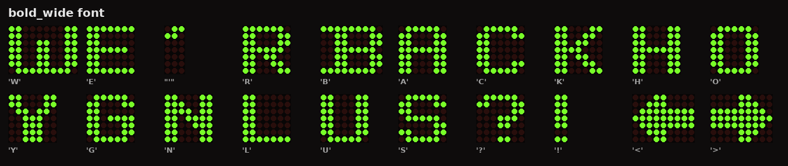
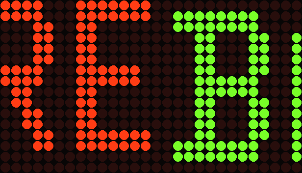

<!--
GBFans post draft (Discourse markdown). Suggested title:
  "Screen-accurate ECTO-1A sign animation — CoolLED file + open data for any LED build"
Suggested category: Equipment > Ectomobiles. Reply in the reference thread too, linking here.
Repository: https://github.com/rmbrumback-lab/ecto-1a-led-sign
Live topic: https://forum.gbfans.com/t/screen-accurate-ecto-1a-sign-animation-coolled-file-open-data-for-any-led-build/219532
Note (1 Nov 2026): this copy includes the iOS / two-panel testing line. The live opening post
couldn't be edited (new-user limits), so the update was posted as reply #4 instead.
-->

# Screen-accurate ECTO-1A sign animation — CoolLED file + open data for any LED build

Building on the incredible research in @prodestrian's [Screen Accurate ECTO-1A Dot Matrix LED Sign (Reference)](https://forum.gbfans.com/t/screen-accurate-ecto-1a-dot-matrix-led-sign-reference/26454) thread, I've turned the community's findings into a working animation of the sign loop. Everything is open and free to use:

* **A ready-to-load file for CoolLED1248 LED panels** (the cheap Bluetooth panels sold on AliExpress and Amazon), 16×96 size.
* **Open frame data** (GIF, PNG frames, sprite sheet, JSON, and an Arduino/C header) so you can drive any LED sign, app, or scratch-built replica.
* **A full attribution audit with evidence cards**: every screen, colour and effect is traced to a post or a reference image, shown side by side with the recreation.

My rule: **everything is attributed.** Where the look of an effect isn't documented, it's clearly labelled as *inferred*, with the evidence behind the guess.

**Download + docs:** https://github.com/rmbrumback-lab/ecto-1a-led-sign
**CoolLED files (pick one):**
* Single file (compressed timing, 22.6 s): https://github.com/rmbrumback-lab/ecto-1a-led-sign/raw/main/dist/Ecto-1A_GB2_16x96.jt
* Two files, screen-timed (44.2 s). Load both and play Part 1 then Part 2:
  * https://github.com/rmbrumback-lab/ecto-1a-led-sign/raw/main/dist/two_part/Ecto-1A_GB2_16x96_Part1.jt
  * https://github.com/rmbrumback-lab/ecto-1a-led-sign/raw/main/dist/two_part/Ecto-1A_GB2_16x96_Part2.jt
**Attribution audit:** https://github.com/rmbrumback-lab/ecto-1a-led-sign/blob/main/docs/ATTRIBUTION.md

---

## Credit where it's due

None of this exists without the people in the reference thread:

* **@prodestrian** worked out the 80×7 red/green matrix, the green-sits-lower quirk, the complete text list, the A–L sequence, and a scene-by-scene breakdown of the film, deleted scenes and premiere footage. That breakdown is the backbone of the animation.
* **@zerosum** contributed the pixel maps, premiere screen grabs, and the **WE'RE BACK book scan**. I read most of the bold font from that scan.
* **@Kingpin** found the 1989 premiere footage (YouTube + Getty), the best reference we have for the sequence. He also nailed that the "yellow" is just red and green lit together.
* **@d_osborn** pointed to the EPK and posted the close-ups.

Thanks also to **auc0le** ([JT-Edit](https://github.com/auc0le/JT-Edit)) and **UpDryTwist** ([coolledx-driver](https://github.com/UpDryTwist/coolledx-driver)). Their open-source work is the only public documentation of the CoolLED file format.

---

## What the sign does (as recreated)

The IDs match prodestrian's A–L frames. It's one loop: 22 seconds in the single file, or 44 seconds in the two-part screen-timed version.

1. **GHOSTBUSTERS** slides up in red, shimmers in green, rapidly swaps red/green about 16 times, then goes solid green.
2. **FOR HIRE…** wipes in from the green, in red inside a **green border**, then a green wipe.
3. **WE'RE READY**, wiped in from the green.
4. **TO BELIEVE YOU**: the highlight moves word by word: TO (green), BELIEVE (amber), then YOU. YOU's colour is my guess. It then wipes down as **CALL JL5-2020** (amber) slides in from the top.
5. A red wipe, then **GHOSTBUSTERS** in green with the shimmer, wiping from green to red, then solid red.
6. A green flash → **WE'RE BACK**, with the words swapping colours.
7. The **five lines → green boxes** graphic. This is my *inferred* reconstruction; see below.
8. **WHO YA** and **GONNA**, then red **CALL?**, which slides up and out. The sign then goes dark briefly.
9. **US!** appears on its own, then the green arrows come on, off and on again.
10. **CALL JL5-2020** opens out from the centre while the arrows are still lit, holds, slides down, and GHOSTBUSTERS rises to start again.

---

## What I inferred, and why

Three things are confirmed to happen on the real sign, but nobody has documented exactly *what they look like*. I've reconstructed them as best guesses, labelled as such everywhere:

**1. The colour wipes.** The thread confirms each wipe and its colour: green into FOR HIRE…, green before WE'RE READY, red into the second GHOSTBUSTERS, and green-to-red within it. Nobody records the direction. In the deleted-scene clip, red sweeps in **from the left** on this sign during the lines → boxes graphic, so I've drawn every wipe left to right.

**2. The shimmer.** It's confirmed on green GHOSTBUSTERS: for a few seconds before the red/green swaps (Getty footage), and after the red wipe (film; the behind-the-scenes footage shows GHOSTBUSTERS, shimmer, GHOSTBUSTERS again). I couldn't measure the thread's shimmer GIFs, so it's rendered as random per-pixel sparkle.

**3. The five lines → green boxes.**
* **Confirmed:**
  * five vertical lines that wipe across and are replaced by green boxes, looping (prodestrian's breakdown of the Getty premiere footage);
  * in the deleted-scene clip, the order red fill → green growing out from inside each section → red sweeping back from the left → green again, with dark dividers during red and red dividers during green.
* **Inferred:** the clip only shows the right third of the sign, out of focus. I assumed five 16-column sections; the clip's spacing measures 14–15 columns, which fits. The full-height fill and number of steps are also my assumptions.

I dropped one thing outright: the possible upside-down flip in GHOSTBUSTERS, since the thread only says "possibly".

**Every element has an evidence card** in the repo, showing the source extract (credited to its poster here and the rights holder) beside my rendering, marked sourced / measured / estimate / inferred: https://github.com/rmbrumback-lab/ecto-1a-led-sign/tree/main/docs/evidence

**If anyone has clear footage of the shimmer, the wipes, or a sharp full-width shot of the lines → boxes, post it and I'll replace the guesses with the real thing.**

---

## How I worked it out

**1. The file format.** CoolLED's `.jt` files turn out to be JSON containing the frames as colour bit-planes. I worked out the layout from JT-Edit and the coolledx driver. I then proved it by re-encoding four files exported by the CoolLED app and getting byte-identical results. One catch: the panel's upload protocol caps a 16×96 animation at **113 frames**. That's why the timing is tighter than in the film.

**2. The sequence.** I took this straight from prodestrian's analysis: what transitions into what, the slides, the solid colour frames, and the colour swaps.

**3. The photos.** I enlarged the stills posted in the thread and laid an 80×7 grid over each one, with perspective correction on the angled shots. That turned up:

* **The sign uses three fonts**, not one:
  * **Bold wide** for WE'RE BACK. B, A, C and K came pixel-for-pixel from zerosum's scan, and the phrase adds up to exactly 80 columns.
  * **Bold narrow** for GHOSTBUSTERS, which runs edge to edge.
  * **Thin 5×7** for CALL JL5-2020 and TO BELIEVE YOU.

* **FOR HIRE…** has a green border.
* **CALL JL5-2020** is amber. You can see both colours lit in the Getty close-up.
* **TO BELIEVE YOU** shows one word highlighted at a time (TO green, BELIEVE amber), so I've animated it word by word through YOU.
* The green shapes beside **US!** are arrows pointing *in* at the word.

**4. The deleted-scene clip.** I went through the Hardemeyer deleted-scene GIF frame by frame, all 181 frames, calibrating colours against things we already know (red US!, green arrows, amber CALL). It showed:

* **WHO YA** and **CALL?** are **red**.
* After CALL?, the sign goes **dark for about 0.8 s**.
* **US!** appears alone first; the arrows then come on for about 1.2 s, go off for 0.8 s, and come back.
* **CALL JL5-2020 opens out from the centre** while the arrows are still lit. You can see "JL5" between the arrows, then "L JL5-20", then the full text. It holds about 2 s, then slides down as red GHOSTBUSTERS rises.

**5. The green offset.** The panel version uses two panel rows per sign row. That let me draw the green half a pixel lower than the red, just like the real sign, where "BACK" doesn't line up with "WE'RE":

---

## Still unknown (shown, but flagged)

These frames are confirmed to exist, but some details aren't:

* the font and colour of **WE'RE READY**, the colour of **GONNA**, and the exact letter shapes of WHO YA / GONNA / CALL?;
* YOU's highlight colour, and the speed of the word-by-word highlight;
* the US! arrowhead shape (the premiere frames are heavily blurred);
* the exact look of the wipes, shimmer and lines → boxes graphic (all inferred);
* the exact timing of everything before CALL? (J–L are timed from the deleted-scene clip; the two-part version uses 2-second holds based on the measured CALL JL5-2020 hold).

Each one is marked in the attribution audit. **A clear shot of GONNA, or a sharp full-width shot of the lines → boxes graphic, would settle most of what's left.** If you have them, please post them.

---

## Using it

* **CoolLED1248 (16×96):** download the `.jt` to your phone (iOS or Android), tap it, and open with CoolLED1248. A single file holds at most 113 frames, so the single-file version compresses the timing. If your panel can play two programmes in a row, use **Part 1 + Part 2** for screen-accurate timing. The app versions that support `.jt` import are 2.x. **Tested:** both the single file and Part 1 + Part 2 play correctly on two separate 16×96 panels, imported from iOS.
* **Any other sign or app:** the repo's `dist/` folder has:
  * `frames_80x7/` — 113 PNGs, 200 ms each
  * a sprite sheet
  * `ecto1a_frames.json` — every frame as 0/1/2/3 values (off/red/green/both, the same scheme prodestrian proposed)
  * `ecto1a_playlist.json` — deduplicated
  * `ecto1a_frames.h` — for Arduino/ESP32
* The `docs/PORTING.md` guide covers making a pixel-exact GIF, scaling to other panel sizes, and driving true red/green LEDs for a full-size replica.
* **Other CoolLED sizes:** the generator script is included. Change two numbers and re-run it.

Code and data are MIT-licensed. The small credited source extracts on the evidence cards belong to their owners and aren't covered by that licence.

If you load it on a panel, I'd love to see a photo. 👻
